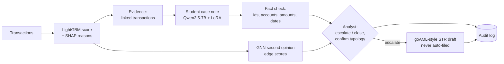
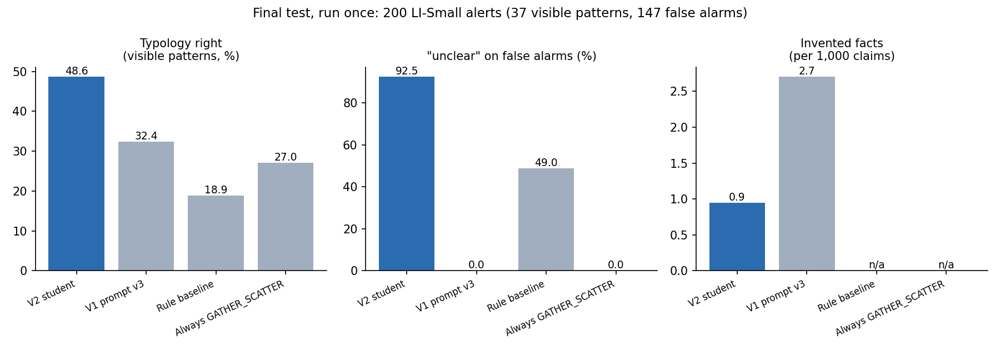

# Explainable AML triage: findings

Research prototype on IBM's synthetic LI-Small transactions. Detailed results are [further down](#step-1-result). Docs: [PRD](PRD.md) · [Architecture](ARCHITECTURE.md) · [V2 plan](docs/V2_PLAN.md) · [Offline demo](docs/OFFLINE_DEMO.md) · [Agent rules](AGENTS.md)

## Problem

Transaction monitoring produces far more alerts than analysts can review, and most are false alarms. A score alone does not help an analyst decide: they need to see why an alert fired, which transactions support it, and a draft note a reviewer can check. Banks also need this to run where the data is, without sending customer transactions to an outside AI service. This pipeline ranks alerts and explains each one from its own evidence. It checks every fact in the note, keeps the analyst as the decision maker, and runs offline on a laptop.

## How it works



LightGBM sets the priority. The GNN is shown beside it as a second opinion, and the case note suggests a typology. The analyst decides everything.

## Results (LI-Small test, 200 alerts, scored once)

| | V1: prompted `gpt-4.1-mini` | V2: fine-tuned student (offline) |
| --- | --- | --- |
| Typology right, laundering alerts whose pattern the evidence shows | 12/37 (32%) | **18/37 (49%)** |
| Says "unclear" on false alarms (147) | 0/147 | **136/147 (93%)** |
| Invented facts per checked claim | 20/7,403 (2.7 per 1,000) | **6/6,351 (0.9 per 1,000)** |
| Valid JSON notes | 200/200 | 200/200 |
| Time per note | Cloud API: 6.5 s | Bank GPU (L4): 11-31 s · 8 GB laptop, offline (Q4_K_M GGUF): 292 s |

| Detector, minority-class F1 (test) | F1 |
| --- | --- |
| LightGBM on LI-Small (this pipeline's priority) | 0.216 |
| GNN, PNA fine-tuned, on LI-Small (second opinion, Project 4) | **0.367** |
| LightGBM on HI-Small (Project 2, for reference) | 0.510 |

LI-Small is harder than HI-Small: it has far fewer laundering transactions per normal one, so the two LightGBM numbers are not a like-for-like comparison.

- **Agreement:** the GNN calls 136 of the 200 alerts low. The UI flags each of these disagreements.
- **Offline model check:** the quantised offline model passed its dev check (50/50 valid JSON, 0/1,189 invented facts, same typology as the full model on 40/50). The test numbers above are the full model's.

## What each project contributes

| Project | Contribution |
| --- | --- |
| 1. aml-alert-investigator | Qwen2.5-1.5B QLoRA on synthetic alerts that gives a typology, risk and reason, inside a 6-step workflow with an audit log (macro-F1 1.000 test, 0.936 held-out). It is the origin of the analyst workflow and the audit log. |
| 2. aml-ibm-experiment | LightGBM ranking on IBM HI-Small against rules. It gets 28.3% recall with 715 alerts, where the rules raise 167,778 (F1 0.510). It adds SHAP reasons and template case notes, the basis of the detector, the reason codes and the V1 note. |
| 3. Fine-tuned case-note student | The first attempt (aml-ibm-finetune) got the typology right 12.0% of the time, against 36.1% for simple graph checks. That led to the reshaped, evidence-only student here: Qwen2.5-7B LoRA trained on teacher notes from HI-Small, the V2 note writer, offline as a GGUF. |
| 4. GNN transfer ([aml-gnn-transfer](../aml-gnn-transfer)) | The LightGBM baseline config and the fine-tuned PNA graph model behind the second opinion |

## Honest limits

- **Small numbers:** n=37 laundering alerts with a visible pattern. The 95% intervals of V1 and V2 overlap (about 20-49% and 33-64%).
- **Weak on two-stage patterns:** scatter-gather was right 1/11 and gather-scatter 5/10. The student sees only one half of the pattern.
- **The dev set missed:** on dev the student scored 3/19, below every baseline. Test was run only because the model was frozen beforehand, and only once.
- **Synthetic data:** IBM's simulated transactions have no customers and no KYC. Nothing here is validated on real bank data.
- **Whole graph versus one bank:** the GNN and the evidence see every bank's transactions. A real bank sees only its own accounts and its counterparties, so the GNN result probably overstates what one bank would get.
- **goAML-style, not certified:** the STR draft follows goAML's main parts but uses our own schema. It is not a UAE FIU format, it is full of placeholders, and it is never filed.
- **Offline speed:** about 5 minutes per note on an 8 GB laptop. That is fine for a demo, slow for a queue.

## Regulatory fit (design intent, not a compliance assessment)

The design follows the main themes of the CBUAE's 2026 guidance note on responsible AI for licensed financial institutions and of the RBI's FREE-AI committee framework (August 2025):

- **Human in the loop:** the model never decides. The analyst escalates or closes and confirms any typology, and drafts are never filed automatically.
- **Explainability:** every alert shows SHAP reasons, the linked transactions and the network graph. Every claim in a note cites a transaction id and is checked, and failing notes are flagged for review.
- **Audit:** each decision, typology confirmation and draft goes into an append-only log, with the note version. A demo reset archives the log; it never deletes it.
- **Data stays local:** the V2 student runs on the bank's own machine through Ollama, with no external API.

Validation, model-risk management and data governance would still be the bank's own work.

## Quick start

```bash
python3 -m venv .venv && source .venv/bin/activate && pip install -r requirements.txt
python -m src.run_step1                                    # alerts, evidence (needs the LI-Small CSV)
streamlit run app.py                                       # UI with the saved student notes
OLLAMA_FLASH_ATTENTION=1 OLLAMA_KV_CACHE_TYPE=q8_0 ollama serve   # offline model (setup: docs/OFFLINE_DEMO.md)
AML_PIPELINE_NOTE_WRITER=ollama streamlit run app.py       # UI that writes new notes offline
```

The UI reads saved files in `artifacts/`, so only the commands that write notes need a GPU or Ollama. See [Run](#run) for details.

---

# Detailed results

## Step 1 result

The detector is the final LightGBM from [aml-gnn-transfer](../aml-gnn-transfer) (Project 4; Phase E, a simple baseline). Retrained here, it reproduces that record exactly (test minority F1 0.2155, PR-AUC 0.1175).

- **200 alerts**, the highest-scored test transactions, each with a score and five SHAP reason codes: `artifacts/alerts.parquet`.
- **53 of the 200 (26.5%) are laundering** (precision@100 over the whole test period is 0.44). The validation threshold flags 479 test transactions in all; the top 200 are all above it.
- **Evidence per alert:** `artifacts/evidence/<alert_id>.json`, linked transactions within 7 days and 2 hops, at most 50 (the nearest in time; each file says how many existed). Two strategies were compared by pattern coverage (below) and the simpler "nearest" one is kept.
- **Ground truth** (evaluation only, never for the LLM): `artifacts/ground_truth.parquet` with `is_laundering` and IBM pattern type. **51 of the 53 laundering alerts map to a known pattern** (scatter-gather 11, gather-scatter 11, fan-out 8, random 6, bipartite 5, cycle 4, stack 3, fan-in 3); 2 are not in `LI-Small_Patterns.txt`.

## Evidence strategy: pattern coverage

Pattern coverage is the share of the true pattern's transactions found in an alert's evidence (the alert transaction counts), averaged over the 51 laundering alerts with a known pattern (mean pattern size 16.3). Evaluation only; it uses the patterns file.

| Strategy | Mean coverage | Median | Alerts with full coverage |
| --- | --- | --- | --- |
| nearest: 50 nearest in time within 2 hops | **0.491** | 0.50 | 7 |
| flow: 15 nearest at hop 1, then 35 along the money trail (onward from the receiver after the alert, backward from the sender before it, 7 days) | 0.486 | 0.50 | 3 |

The two are the same within noise, so "following the money" did not help here, and the higher one ("nearest") is kept (`config.EVIDENCE_STRATEGY`). The flow evidence is still written to `artifacts/evidence_flow/` for comparison. Caveat: this choice was made on the 200 test alerts' ground truth, between two options only; it is not a tuned result. The pipeline's own steps (detector, reasons, evidence) never read a label.

## Step 2 result: prompt-only LLM case notes

Model `gpt-4.1-mini`, temperature 0, JSON-schema output. Input = score + plain-English SHAP reasons + evidence (no label, no pattern). Totals are computed in code from the cited ids. Every cited id, account and text amount (also those written in red flags and questions) is checked against that alert's evidence; a note with any violation, or still invalid after one retry, is flagged `needs_review`. The LLM no longer decides: it gives a typology, red flags and 3 investigator questions, and alert priority is the detector score (`priority_rank`).

**Finding (v1, when the LLM still decided).** On the 200 test alerts the LLM escalated 81; 22 were laundering: precision 0.27, recall 0.43. The alert list is 26% laundering (51 of 200), so LLM escalate precision 0.27 is about the base rate and it added nothing. That is why the decision was removed. (On 30 dev alerts, v1 precision was 0.90 and v2 0.82, which shows how misleading a small dev set can be.)

Prompt v3 (v2's typology definitions, no decision, questions) was checked on the dev set first (30 top validation alerts): 30/30 valid, 0 notes with invented facts, typology 3/22 mapped. Then run once on the test set (`artifacts/eval_step2.json`):

| | v1 (200 test, 1,200-token cap, LLM decides) | v3 (200 test, 3,000-token cap, one retry) |
| --- | --- | --- |
| JSON valid | 190/200 | **200/200** |
| Typology accuracy (mapped alerts) | 13/49 = 0.27 | 13/51 = 0.25 |
| Notes with invented facts / needing review | 12/190 = 6.3% | 17/200 = 8.5% |
| Invented facts per checked claim | 0.75% | 0.27% |
| Cost | $0.67 | $0.72 (about 6.5 s per note) |

Typology accuracy is poor: about one in four, so the typology is a hint for the analyst, not a result. The fact check is what makes the notes usable: 183 of 200 notes had every cited id, account and amount in the evidence, and the other 17 are flagged for review. Prompts v1 and v2 are kept for the record but target the old schema (with a decision).

## V2 step 1: fine-tuning data for the case-note model (Project 3)

A teacher (`gpt-4.1-mini`, temperature 0) writes gold case notes for HI-Small alerts. It sees the student's exact input plus a `PRIVILEGED_TRUTH` block (typology and pattern transaction ids, or "not laundering"); the student never does (documented exception in AGENTS.md). Alerts are the top-scored HI-Small validation and test transactions from the same LightGBM; LI-Small test alerts are never used for training. A teacher note is kept only if it passes the fact check, uses the typology it was given and cites the pattern transactions.

- **2,400 candidates, 2,399 kept** (1 dropped: it mentioned a "label"). 1,237 of the kept are laundering. 2,145 notes were reused from the earlier dataset and 255 regenerated (47 flagged as relying on reason sentences, 8 earlier drops, 200 new false alarms): teacher cost $0.86 this round (the first dataset cost $7.74, the second $0.55).
- **Train 2,180 / validation 219 / dev 50 (LI-Small validation period) / test 200 (the existing alerts)**. Train and validation share no pattern. Train keeps every laundering example (796 typed, 308 laundering whose evidence is too thin, answered "unclear") and 1,076 false alarms: **50.6% laundering** (the target was 50%; 28 more false alarms would have been needed for exactly 50%, and 200 train-only false alarms were added from the pool for this). So **"unclear" is 63.5% of train** (false alarms 49% plus thin laundering 14%) and 53% of validation, which is unchanged. The test alerts are 26.5% laundering.
- **Student input (prompt v4) is the evidence only**: the alert transaction id and the transactions. No model score, no SHAP reasons, no alert id and no count of linked transactions (that count is 210 / 410 in the median for false alarms / laundering in train but 687 / 2,058 on dev, so a student could learn thresholds that do not carry over). The reasons stay in the UI and the alert table. It is written without indentation because with Qwen's one-token-per-digit numbers the indented form does not fit 8,192; an example is 6.9k tokens on average, 8,075 at most. Prompt v4 is v3 without the sentences that mention the score and the reasons; the teacher prompt likewise.
- **Reused notes** were checked for claims that only the removed input could support (counts over the last hour or days, new senders, usual amounts, "times the", earlier payments, the found count): 47 of 2,192 were regenerated. This is a wording check, so a subtler dependence on the reasons the teacher once saw cannot be excluded; regenerating all notes would cost about $8.
- **`pattern_visible`** (at least 3 of the pattern's transactions in the evidence) is stored per example in `data/finetune/meta.jsonl`. Where it is false the teacher was told to answer "unclear".

### First student, and what was wrong

The first student (trained on the scored input) scored 10/19 typology on the 19 dev alerts with a visible pattern, below always answering GATHER_SCATTER (11/19); it answered "unclear" for none of the 20 valid false alarms and GATHER_SCATTER for 42 of 50 answers. The input format was identical to training. The cause was a shortcut: in training an alert with score 1.0 was laundering 96% of the time (35 saturated false alarms exist in the whole HI-Small pool of 60,000), while all 50 dev alerts score 1.0 and 42% are false alarms; the first reason also differed ("payment format is ACH" 93% in train, 26% in dev). The score, the reasons and the found count are therefore gone from the input.

Cue distributions are in `data/finetune/cue_report.json` (`python -m src.run_finetune cues`); they describe the alerts, not what the student sees any more. They could not be matched by choosing different HI-Small alerts:

| | Train, first | Train, now | Dev | Test (reported, not used) |
| --- | --- | --- | --- | --- |
| Laundering share | 69% | 51% | 58% | 26.5% |
| Score saturated at 1.0 | 32% | 23% | 100% | 82% |
| Laundering share inside score 1.0 | 96% | 93% | 58% | 33% |
| First reason is payment format | 93% | 89% | 26% | 35% |
| First reason is sender_sent_7d | 0% | 3% | 74% | 43% |

Prompt v4 (OpenAI) on the new evidence-only dev inputs, cost $0.19: typology 2/18 on visible-pattern laundering (it answers FAN_OUT for 36 of 49 notes), "unclear" 0/21 on false alarms, invented facts 2/1,783, JSON 49/50. With the score and reasons it scored 8/19 (v3: 5/19), so the reasons were doing the work for the LLM; always answering GATHER_SCATTER gets 11/19. The retrained student is not trained or scored yet.

### Evaluation scheme (V1, prompt v3 and the student alike)

`src/eval_v2.py`. Five measures, on the 200 test alerts (37 laundering alerts with a visible pattern, 147 false alarms):

| | V1 | v3 |
| --- | --- | --- |
| Typology accuracy, visible-pattern laundering | 12/35 = 34% | 12/37 = 32% |
| "Unclear" rate on false alarms | 0/139 | 0/147 |
| "Unclear" rate on visible-pattern laundering | 0/35 | 0/37 |
| Invented facts per claim | 53/7,033 = 0.75% | 20/7,403 = 0.27% |
| JSON validity | 190/200 | 200/200 |

Neither prompt ever answers "unclear", even on false alarms. That, and typology on visible patterns, is what the student is meant to improve. These are the scored-input prompts; prompt v4 has not been run on the test set. The retrained student is not trained or scored yet.

### Student training (not run)

`notebooks/finetune_colab.ipynb`: QLoRA on `Qwen/Qwen2.5-7B-Instruct` (set in one config cell; the notebook prints the model card's licence, listed as Apache-2.0), 8,192 tokens, 1 epoch, validation loss at the end, adapter saved to Drive. `src/student_generate.py` (run in Colab) writes the notes for the 50 dev alerts, then the 200 test alerts once (at most 1,400 new tokens; an answer cut off there is invalid; one retry with repetition penalty 1.1 for an invalid answer); `python -m src.score_student --set dev|test --raw <file>` (the notebook's answer files are named `dev_raw_<model>_<run>.jsonl`, so an old run's answers are never reused) applies the same fact check and `eval_v2` on a CPU. Drive folder `aml_finetune/` needs exactly: `train.jsonl`, `validation.jsonl`, `dev_inputs.jsonl`, `test_inputs.jsonl`, `val_inputs.jsonl` (from `data/finetune/`) and `student_generate.py` (from `src/`); re-upload all six for each data version (the run name `evidence1` keeps adapters apart). Estimate, not measured: about 7.5-8 h on an L4 for the one training epoch (6-9.5 h range) and about 1 h for the 250 notes, roughly 15 Colab compute units (11-18). Run with `MAX_STEPS = 3` first to measure the real speed. The first smoke test ran out of memory in the loss (8k x 152k logits), so the notebook now uses Liger's fused cross-entropy (the logits are never built), `expandable_segments`, pinned package versions and a `USE_SMALLER_MODEL` switch (Qwen2.5-3B-Instruct); these fixes are not yet confirmed on a GPU.

### Student result on dev, and the diagnosis

First 7B student (`evidence1`, 1 epoch, validation loss 0.1538, about the earlier student's 0.151) on the 50 dev alerts: "unclear" for all 50, typology 0/19 on visible patterns, invented facts 2/1,235 claims, JSON 50/50. Not scored on test. Diagnosis (`python -m src.run_diagnose val|format|targets|rules`, CPU only, report in `data/finetune/diagnosis.json`):

- **Inputs match.** Dev, test, validation and the new val inputs all have train's system prompt (one, identical), user-message keys and order, transaction field order and compact JSON. What differs is content: dev evidence is 98% hop-1 and 0% hop-2 (train 77% / 21%; test 90% / 8.5%), because dev's alert accounts are hubs (median 160 hop-1 transactions vs 47 in train), so the 50-transaction cap is filled before any hop-2 money flow appears.
- **Targets.** Train: 1,384 of 2,180 notes (63.5%) say "unclear" (all false alarms and thin-evidence laundering); every visible-pattern note is typed (GATHER_SCATTER 231, SCATTER_GATHER 145, CYCLE 115, FAN_IN 115, FAN_OUT 114, RANDOM 76). The typology value is 7,445 of 1,727,314 train loss tokens (0.43%, Qwen tokenizer, about 792 loss tokens per note), so validation loss says almost nothing about typology.
- **Rule baseline (no LLM, tuned on dev only).** `src/typology_rules.py` reads cycle, scatter-gather, gather-scatter hub, fan-in and fan-out off the evidence graph near the alert. Best on dev: 11/19 visible, 3/21 false alarms "unclear" (window 24 h, 4 counterparties, hub with 1 payer), which is the always-GATHER_SCATTER baseline (11/19, 0/21) in disguise: it says GATHER_SCATTER for 42 of 50. With a real hub (2+ payers) the best is 7/19. The same settings on the HI-Small val set: 5/20 (always-GATHER_SCATTER: 3/20). So on dev the graph rules do not beat the constant either; dev's typology is hard to read from this evidence.
- **HI-Small val set.** `data/finetune/val_inputs.jsonl`: 50 held-out HI-Small validation alerts in the dev input format (20 visible patterns, 3-4 per typology, new pattern attempts first; 20 false alarms; 10 thin-evidence laundering), identical to their `validation.jsonl` prompts. The notebook's val cell writes `val_raw_<run>.jsonl` (inference only); score with `python -m src.score_student --set val --raw <file>`. Result for `evidence1`: typology 1/20 visible, "unclear" for 18/20 visible and 18/20 false alarms, invented facts 1/1,111 claims, JSON 50/50. The student did not learn typology at all, even on HI-Small; the LI shift is not the first problem.

### Final retrain: `typology2`

`python -m src.run_finetune v3` writes `data/finetune/train_v3.jsonl` (report in `train_v3_report.json`) from the same examples and teacher notes, only a new mix: 1,292 examples (1,152 distinct alerts), 140 per typology (GATHER_SCATTER capped from 231, new pattern attempts first; RANDOM 76 repeated to 140; the others 114-145 capped or topped up), "unclear" 452 (35%, was 63.5%): 339 false alarms and 113 thin-evidence laundering, nothing else. The typology is already the first field of every note (checked; moved there if not). Validation and every test file are untouched.

Notebook (`RUN_NAME = "typology2"`): trains on `train_v3.jsonl` for 2 epochs, the typology value tokens weigh 5x in the loss (an extra cross-entropy on those few positions from the final hidden states, since the fused loss cannot weight tokens; validation loss stays unweighted), checkpoints every 20 steps. 9.0M Qwen tokens per epoch, 81 steps per epoch. Estimate, not measured: about 9.6 h on an L4 (550 tokens/s assumed, 7-12 h range). The weighted-loss code has not run on a GPU yet; run `MAX_STEPS = 3` first.

**Gate.** The notebook writes the val notes first. `python -m src.score_student --set val` prints `gate`: pass only if typology is right for at least 10 of 20 visible patterns and at least 50% of false alarms are "unclear". Only then set `VAL_GATE_PASSED = True` and run dev; test runs once, last. `evidence1` fails it (1/20, 90%).

### `typology2` results and review

HI-Small val: typology 12/20, "unclear" on 16/20 false alarms (val gate passed), invented facts 2/1,036 claims (fixed check). LI-Small dev: typology 3/19 on visible patterns, "unclear" on 20/21 false alarms and 0/19 visible patterns, invented facts 17/1,391 claims with the old check, 18/1,391 with the fixed one (below), JSON 50/50. **Dev gate missed** (3/19; dev was not formally gated, but this is far below val). `python -m src.run_review confusion|invented|evidence2` (CPU, report in `data/finetune/review.json`):

Confusion, HI-Small val (rows true, columns predicted; "unclear (thin)" = laundering whose pattern the evidence does not show):

| true \ predicted | FAN_OUT | FAN_IN | GATHER_SCATTER | SCATTER_GATHER | CYCLE | RANDOM | unclear |
|---|---|---|---|---|---|---|---|
| FAN_OUT | **3** | . | . | . | . | . | . |
| FAN_IN | . | **4** | . | . | . | . | . |
| GATHER_SCATTER | 1 | . | **1** | . | . | . | 1 |
| SCATTER_GATHER | . | 2 | 1 | **0** | . | . | . |
| CYCLE | . | . | . | . | **1** | 3 | . |
| RANDOM | . | . | . | . | . | **3** | . |
| unclear (thin) | . | . | . | . | . | 2 | **8** |
| false alarm | . | 2 | . | 2 | . | . | **16** |

Confusion, LI-Small dev:

| true \ predicted | FAN_OUT | FAN_IN | GATHER_SCATTER | SCATTER_GATHER | CYCLE | RANDOM | unclear |
|---|---|---|---|---|---|---|---|
| FAN_OUT | **1** | . | . | . | . | . | . |
| GATHER_SCATTER | 6 | 2 | **2** | 1 | . | . | . |
| SCATTER_GATHER | 1 | 4 | . | **0** | . | . | . |
| CYCLE | 1 | . | . | . | **0** | 1 | . |
| unclear (thin) | 1 | 1 | . | 1 | . | 1 | **6** |
| false alarm | . | . | . | . | 1 | . | **20** |

The fan typologies are learned; the two-stage ones are not: SCATTER_GATHER is 0/3 on val and 0/5 on dev (read as FAN_IN), GATHER_SCATTER 1/3 and 2/11 (dev: mostly read as FAN_OUT), CYCLE 1/4 (read as RANDOM). Dev is 11/19 GATHER_SCATTER, so this weakness costs most there. Dev evidence had no hop-2 rows, so the second stage of a pattern was rarely visible.

Invented facts on dev (17, in 4 of 50 notes): 14 transaction ids (13 in the text, 1 in `cited_txn_ids`), 3 amounts, 0 accounts. 13 of the ids continue a run of consecutive evidence ids by 1-2 (for example 3971603 when the evidence has 3971604-3971609; 10 of them in one note, A0001); 1 is 6 below such a run. The 3 amounts (A0040) are evidence amounts with the decimal point moved one place (295,474.62 written as 29,547.46). Counts and dates are not fact-checked, so none can be counted. The old check missed amounts with one decimal: A0040's "19,969,689.1" (1,996,968.91 moved) was a further invented amount; the fixed check catches it (18).

### Evidence v2 (dev and test inputs only, no retraining)

Strategy `capped`: the nearest in time as before, but at most 35 hop-1 and 15 hop-2 rows (v1: 50, hop 1 first). Written to `evidence_v2/` beside `evidence/` (dev: `artifacts/dev_finetune/`, test: `artifacts/`) and as `data/finetune/dev_inputs_v2.jsonl` and `test_inputs_v2.jsonl`, in train's exact input format (checked). Train's own evidence stays v1. Rule settings tuned on dev only, per version; test scored with them, never tuned.

| | dev v1 | dev v2 | test v1 | test v2 | train |
|---|---|---|---|---|---|
| hop 1 / hop 2 share of linked rows | 100% / 0% | 70% / 30% | 91% / 9% | 69% / 31% | 77% / 21% |
| alerts with no hop-2 row | 50/50 | 0/50 | 147/200 | 0/200 | |
| mean pattern coverage (laundering with a known pattern) | 0.278 (28) | **0.217** | 0.491 (51) | **0.466** | |
| pattern visible (3+ of its rows) | 19 | **16** | 37 | 37 | |
| rule baseline, right typology on visible | 11/19 | 9/16 | 7/37 | 3/37 | |
| rule baseline, "unclear" on false alarms | 3/21 | 19/21 | 72/147 | 121/147 | |
| always GATHER_SCATTER | 11/19 | 9/16 | 10/37 | 10/37 | |

v2 gives dev the hop mix train had, but it **lowers pattern coverage** (dev 0.278 to 0.217, 3 fewer visible patterns; test 0.491 to 0.466): for these hub alerts more of the pattern sat in hop-1 rows 36-50 than in the 15 hop-2 rows that replace them. The rule baseline does not beat the constant on either version. Whether the student does better on v2 (closer to its training input) is not known until it is run on `dev_inputs_v2.jsonl`; the dev scoring for v2 needs `pattern_visible` from v2 evidence, which `score_student` does not compute yet.

### Decision: freeze `typology2` and run test once

The dev result misses: 3/19, below always-GATHER_SCATTER (11/19), the rule baseline (11/19) and V1 prompt v3 (5/19). The student did not learn the two-stage patterns (GATHER_SCATTER, SCATTER_GATHER), and dev is 11/19 GATHER_SCATTER. Evidence v2 is not used (dev v2 skipped: it lowered pattern coverage). Frozen: the `typology2` adapter and the v1 test inputs (`data/finetune/test_inputs.jsonl`, md5 `fe604b2b37bfa403a0c7f53d2ceb8792`, all 200 match `artifacts/evidence/`). Test is the final evaluation, run once; nothing changes after it, whatever the result.

**Fact check fixed before test** (`src/fact_check.py`): amounts with one decimal ("13,775.6") are now checked, numbers with a scale ("4.8 million", "2.5%") are skipped, and ISO dates in the text must be dates of evidence transactions. Counts are not checked: in gold teacher notes "two payments" cites one id in 237 of 307 such phrases, so a count rule would flag wording. On the 2,180 gold teacher notes the fixed check flags 1 ("totaling 15790.4 EUR"). Val and dev were re-scored with it (numbers above).

**Scoring test (on a CPU, once):**

```bash
python -m src.score_student --set test --raw data/finetune/test_raw_Qwen2.5-7B-Instruct_typology2.jsonl
```

It refuses any file but the `typology2` run's, and refuses a second scoring (`artifacts/student_vs_baselines.json` exists). The report gives the student's typology on visible patterns, "unclear" on false alarms, invented facts and JSON validity, beside always-GATHER_SCATTER, the rule baseline (settings fixed from dev: 24 h, 4 counterparties, hub with 1 payer; `RULE_SETTINGS_FROM_DEV`) and V1 prompt v3 (gpt-4.1-mini) re-checked with the fixed fact check. V1 v3 saw the model score and SHAP reasons as well as the evidence; the student saw the evidence only. The notebook's test cell reads `test_inputs.jsonl` and writes `test_raw_Qwen2.5-7B-Instruct_typology2.jsonl` with the `typology2` adapter; it resumes only from that file, so the old `evidence1` answers are never read. After a restart, run only the settings cell and the test cell.

## Final test result (run once on the frozen student)

The `typology2` student was run once on the 200 LI-Small test alerts (v1 evidence inputs) and scored once. Nothing was changed after. Table: `results/final_test.md` (`python -m src.final_results`).

| System | Typology right (visible patterns) | "unclear" on false alarms | Invented facts per claim | JSON valid |
| --- | --- | --- | --- | --- |
| **V2 student (Qwen2.5-7B + LoRA typology2)** | **18/37 (48.6%)** | **136/147 (92.5%)** | **6/6,351 (0.9 per 1,000)** | 200/200 |
| V1 prompt v3 (gpt-4.1-mini) | 12/37 (32.4%) | 0/147 (0.0%) | 20/7,403 (2.7 per 1,000) | 200/200 |
| Rule baseline (settings from dev) | 7/37 (18.9%) | 72/147 (49.0%) | n/a (no text) | n/a |
| Always GATHER_SCATTER | 10/37 (27.0%) | 0/147 (0.0%) | n/a (no text) | n/a |



**Caveats:**

- **n=37.** 18/37 has a 95% interval of about 33-64%, and V1's 12/37 about 20-49%. They overlap, so "better than V1" is likely but not settled. The student is right on about half the visible patterns, so its typology is a suggestion, not a result.
- **Two-stage patterns are still weak.** SCATTER_GATHER was right 1/11 (10 were called FAN_IN) and GATHER_SCATTER 5/10 (5 were called FAN_OUT). The student sees one half of the pattern. FAN_OUT 5/7 and FAN_IN 3/3 carry most of the score.
- **The dev result missed** (3/19, below every baseline). Test went ahead only because the model was frozen beforehand, not because dev passed. Dev (50 alerts, 11/19 GATHER_SCATTER) and test disagree a lot, which is one more reason to read every number here as small-sample.
- **Run once on a frozen model.** No setting was chosen on test (the rule settings came from dev). `score_student` refuses a second test scoring.
- "Unclear" is cheap to say. 92.5% on false alarms comes with 1/37 "unclear" on visible laundering and 15/16 on laundering whose pattern the evidence does not show. The student says "unclear" whenever the evidence is thin, so a typed answer means it found a shape.
- **V1 saw more input than the student** (score and SHAP reasons) and makes more claims per note. Invented facts are counted with the same fixed check for both. 6 student notes need review.

**The student is now the V2 note writer.** `config.NOTE_WRITER = "student"` (the default; `AML_PIPELINE_NOTE_WRITER=prompt_v3` switches back to V1). The UI reads `artifacts/notes_student.json` and shows "Suggested typology: X (fine-tuned student; analyst confirms)". The audit log records `v2-student-typology2` with each decision. For new alerts, `python -m src.note_writer inputs | generate | notes`: `generate` needs a GPU and the adapter at `config.STUDENT_ADAPTER_DIR` (`models/`, git-ignored; or set `AML_PIPELINE_STUDENT_ADAPTER`), and `notes` fact-checks each answer against its own evidence without reading ground truth. The metrics page shows the final test beside V1.

**Remaining V2 steps** (short plan in [docs/V2_PLAN.md](docs/V2_PLAN.md)): 1. GNN scores and edge colours (done); 2. goAML draft (done); 3. offline GGUF / Ollama demo (done; runs on an 8 GB M2 at about 5 min per note).

## V2 step 1: GNN second opinion (export ready, not run)

**What Project 4 (aml-gnn-transfer) saved** (read only; its records are in `results/phases/`, its checkpoints on Drive under `MyDrive/aml-gnn-transfer/<set>/models/<run_id>/checkpoint_True_finetuned.tar`). LI-Small minority F1:

| Fine-tuned run | Labels | Seed | Validation F1 | Test F1 |
| --- | --- | --- | --- | --- |
| **PNA `pna_finetune_f1.0_s0`** (phaseD) | 100% | 0 | **0.332** | 0.367 |
| PNA `pna_finetune_f0.25_s0` (phaseD) | 25% | 0 | 0.286 | 0.358 |
| PNA `pna_finetune_f0.1_s0` (phaseD) | 10% | 0 | 0.273 | 0.327 |
| GIN `gin_finetune_f1.0_s0_b20` (phaseA) | 100% | 0 | 0.303 | 0.349 |
| GIN `gin_finetune_f1.0_s1` (phaseC) | 100% | 1 | 0.276 | 0.344 |
| GIN `gin_finetune_f0.25_s0` / `_s1` (phaseC) | 25% | 0 / 1 | 0.261 / 0.279 | 0.336 / 0.256 |
| GIN `gin_finetune_f0.1_s0` / `_s1` (phaseC) | 10% | 0 / 1 | 0.237 / 0.238 | 0.305 / 0.291 |

All runs are `completed`. The chosen model is the PNA with 100% of labels, **chosen by validation F1** (it also has the best test F1, but test was not used to choose). It has one seed only. For comparison, our LightGBM detector has test F1 0.216.

**Export:** `notebooks/gnn_scores_colab.ipynb` runs `src/gnn_export.py` (self-contained, uploaded to Drive) inside a fresh clone of aml-gnn-transfer at commit `5fe1302`. It reuses that repo's loaders and checkpoint loading, and keeps the id of every scored edge. Multi-GNN's edge k is row k of the time-sorted `formatted_transactions.csv`, whose EdgeID is our `transaction_id`. Output: `gnn_scores.parquet` with transaction_id, score and period, for validation and test (2.49M rows, no label). **Fix after the first Colab run** ("Scored edges differ from the period's edges"): Multi-GNN's loader starts a batch from each seed's two accounts and samples a capped number of their edges, so a busy account's own seed edge can be left out of its batch. Multi-GNN adds such edges back only for its Small_J / Small_Q data, and aml-gnn-transfer's scorer does not, so those edges were never scored, and **the recorded F1 covers only the edges the sampler kept**. The export now adds them back the same way Multi-GNN does (the forward edge only), flags them in an `added` column, and still stops unless every edge of the period is scored exactly once. If not, it prints the expected, scored, missing, extra and duplicate counts with 5 examples each. As a check that the right model loaded, F1 on the sampled edges only is compared with the record (0.332 / 0.367, tolerance 0.01); F1 on all edges is printed beside it. Estimate, not measured: 25-35 min on an L4 (about 0.5 h, ~1 unit), mostly environment setup; the scoring itself took 249 s in the original run.

**Export result:** 2,491,115 scores (1,316,442 validation, 1,174,673 test), 0 missing, extra or duplicate; the sampler had dropped 26 validation and 1,412 test edges, now added back. **The Project 4 (aml-gnn-transfer) F1 is unchanged when the sampler-dropped edges are added back: 0.332 validation / 0.367 test, on the sampled edges and on all edges alike.**

**Built:** `src/gnn_scores.py` joins the scores to the 200 alerts. Of the 10,182 evidence rows, 8,519 are scored and 1,663 are in the GNN's training period and stay unscored; no row from 2022-09-07 on lacks a score (`python -m src.gnn_scores` checks this). In the UI:
- **Alert detail:** a header "GNN second opinion: 0.00, low (higher than 28.6% of test transactions). Priority is set by the LightGBM score." and a `gnn_score` column in the evidence table. When one model is high and the other low (LightGBM above its validation threshold, GNN below 0.698, or the reverse), a badge says so, e.g. A0003: LightGBM 1.00, GNN 0.00.
- **Queue:** `gnn_score` and `lightgbm_vs_gnn` (agree / disagree) columns, sortable; the default order stays LightGBM priority. **The models disagree on 136 of the 200 alerts**: every alert is above the LightGBM threshold, and the GNN calls 136 of them low. The metrics page shows the count.
- **Network graph:** full width below the evidence and the note, 720 px high. A toggle switches "Colour edges by: note citations | GNN score". GNN mode is readable in the dark theme: dim grey (low) to yellow to bright red (high), thicker from 0.698, light grey dashed for unscored and a cyan outline on the alert (red now means a high score). It has a colour bar with the 0.698 tick and a legend. Only the alert's accounts, the cited ones and the note's key accounts are labelled; the others show on hover.
- 64 of the 200 alerts are "high"; Spearman correlation between the GNN score and the LightGBM rank is 0.69 (no labels used).
- Without `artifacts/gnn_scores.parquet` the UI works as before.

**Design:** see [docs/V2_PLAN.md](docs/V2_PLAN.md). LightGBM keeps the priority; the GNN is a second opinion in the header, the queue, the evidence table and an optional edge colouring with a legend. 1,663 of 10,182 evidence rows (16%) fall in the GNN's training period and stay unscored (grey), because their scores would reflect labels the model was trained on.

## V2 step 2: goAML-style STR draft (UAE first)

**This is a goAML-style draft, not a certified UAE FIU schema. It is never filed automatically.** An alert gets a "Draft goAML report" button only when the analyst's latest decision is "escalate". When escalating, the analyst can confirm the suggested typology with a checkbox, and only a confirmed typology goes into the draft (as a `report_indicators/indicator`).

- **Parts** (`src/goaml_draft.py`):
  - **Header:** reporting entity (`rentity_id`, branch, reporting person, location), `submission_code` E and `report_code` STR, the alert id as `entity_reference`, and local currency AED.
  - **Reason:** the case note's reason and red flags plus the analyst's comment, capped at 4,000 characters.
  - **Transactions:** the alert transaction, then each cited evidence row in time order. Each has its date, payment format and, for both sides, the original currency and amount and the bank id and account number.
  - **Report parties:** the note's key accounts. For a confirmed FAN_IN, the senders of the cited transactions are added; for a confirmed FAN_OUT, their receivers. An unconfirmed typology adds nothing. On A0002 (FAN_IN confirmed), that makes 1 key account + 8 senders.
  - **AED amounts:** a USD row gets `amount_local` and `foreign_exchange_rate` at the dirham's USD peg (3.6725 AED per USD), and `internal_ref_number` says so. Other currencies stay `MISSING`, because their rate on the day is not in the data.
- **Missing data:**
  - What the pipeline cannot know is written as `MISSING: <what>`: KYC names and countries, institution names, SWIFT, reporting entity id and address, FIU codes for funds type and transfer mode, AED amounts and exchange rates.
  - The UI lists every kind with its count and where it occurs. A three-transaction draft has 19 kinds; A0001's has 62 placeholders.
- **Schema:** `docs/goaml_style_draft.xsd` is our own, checked with lxml (`src/goaml_check.py`). It borrows goAML's element names but is not the UNODC or UAE FIU schema. The notice is in the XML twice, as a comment and as a `draft_notice` element the schema requires.
- **UI:** the draft section sits under the decision form. It shows the schema result, the missing-fields table, a warning if the note failed the fact check, the XML preview and the download (`goaml_style_draft_<alert>.xml`). Each draft adds a `goaml_draft` line to the audit log, with the placeholders left and the typology included. Draft lines do not count as decisions.
- **Audit log:** the decision form shows the saved decision and whether the typology was confirmed. To reset a demo, run `python -m src.audit_log clear --yes` (command line only, not in the UI). It moves the log to `artifacts/audit_log_archive/` with a timestamp, so nothing is deleted.
- **Limits:**
  - IBM's synthetic data has no customers, so every party detail is a placeholder.
  - Transfer-mode and funds codes need the FIU's lookup lists.
  - The FIU-IND (FINGate) adapter is planned, not built ([docs/V2_PLAN.md](docs/V2_PLAN.md)).

## V2 step 3: offline demo with Ollama

The student runs on a laptop, without a GPU or internet, as one **Q4_K_M GGUF** (about 4.7 GB) served by Ollama. Its notes go through the unchanged fact check. Step-by-step guide: [docs/OFFLINE_DEMO.md](docs/OFFLINE_DEMO.md).

- **Export** (`notebooks/gguf_ollama_colab.ipynb`, L4):
  - It merges the frozen `typology2` adapter into Qwen2.5-7B-Instruct (bf16), converts it to GGUF with llama.cpp and quantises it to Q4_K_M.
  - Only that file, plus its sha256, is saved to Drive. The merged fp16 model and the f16 GGUF stay on Colab's local disk and are deleted as soon as each step is done.
  - Estimate, not measured: 45-75 min, about 1-1.25 L4 hours (~2-2.5 units). Colab local disk peaks at ~31 GB; Drive needs ~5 GB.
- **Same prompt and format as training:** `ollama/Modelfile` uses Qwen's chat format with no default system prompt (the caller sends the v4 prompt and the evidence). Decoding is greedy with `repeat_penalty 1.0` (Ollama's default is 1.1), an 8,192-token context and at most 1,400 new tokens. `src/ollama_generate.py` (standard library only) keeps student_generate's retry rule: one retry with penalty 1.1 for an invalid answer.
- **`NOTE_WRITER="ollama"`:** the UI shows the adapter's saved notes, and "Regenerate note (local Ollama, offline)" writes a new one with the GGUF. `python -m src.note_writer ollama --alert A0001` runs one alert end to end and times it. Both use the same `student_record` parsing and fact check. Ollama answers are demo output and are never scored.
- **Quantisation check, dev only** (`src/quant_check.py`): the GGUF's answers on the 50 dev alerts are compared with the adapter's.
  - Pass rules, fixed beforehand: valid JSON at most 2 below the adapter, invented facts per claim at most twice the adapter's (1.3%), and the same typology on at least 80% of alerts.
  - It refuses non-dev files. Test stays the adapter's single scored run.
- **Result of the dev check (50 dev alerts, run once; test untouched):** it passed all three rules, but the typology rule only just.

  | Dev, 50 alerts | Adapter (NF4 + LoRA) | Q4_K_M GGUF |
  |---|---|---|
  | Valid JSON | 50/50 | 50/50 |
  | Invented facts / checked claims | 18/1391 (1.3%) | 0/1189 (0%) |
  | Typology right on visible patterns | 3/19 | 1/19 |
  | Same typology as the adapter | | 40/50 (0.80, the minimum to pass) |
  | Identical notes | | 0/50 |

  - **What this means:** the GGUF writes valid, fact-checked notes. It is a slightly different model, not a copy: no note is word for word the same, it makes fewer claims (1189 against 1391), and it changes the typology on 10 of 50 alerts. It gets fewer typologies right (1/19 against 3/19), but with 19 alerts that gap is two alerts.
  - **What it doesn't show:** 0 invented facts on 1189 claims doesn't make it more factual than the adapter. Shorter notes give fewer chances to invent, and the sample is small.
  - **Use:** the GGUF is the offline demo writer. The reported results (test, above) stay the adapter's.
- **Mac run (Apple M2, 8 GB memory, Wi-Fi off), one test alert:**
  - A0001 took **292 s** (about 5 min) for 708 output tokens. The fact check was clean.
  - The GGUF suggested **RANDOM**; the adapter's saved note says *unclear*. This is the same kind of typology shift as on dev. The typology is a suggestion the analyst confirms, so the UI shows it with that label.
  - The UI and "Regenerate note (local Ollama, offline)" both worked with Wi-Fi off.
  - This alert was a demo; nothing on test was scored again.
- **Speed tips for a live demo:**
  - Close the browser tabs and other apps you don't need, because 8 GB is tight and swapping slows each note a lot.
  - Start the server with `OLLAMA_FLASH_ATTENTION=1 OLLAMA_KV_CACHE_TYPE=q8_0`.
  - Start the note early: click "Regenerate" first, then talk through the evidence, the graph and the goAML draft while it writes (about 5 min).
- **Caveats:**
  - The adapter was trained on a 4-bit NF4 base and is merged into bf16, then quantised again. That is why the dev check exists, and why the typologies differ.
  - The timing comes from one alert on one machine.

## Run

```bash
python3 -m venv .venv && source .venv/bin/activate
pip install -r requirements.txt
python -m pytest -q
python -m src.run_step1      # about 10 minutes the first time (features are cached)
```

The raw CSV is read in place from `~/aml-gnn-transfer/data/Small_LI/` (set `AML_PIPELINE_RAW_CSV` to use another path). Nothing from `artifacts/`, `cache/` or the data is committed.

LightGBM on a Mac without Homebrew fails with "Library not loaded: libomp.dylib". Either `brew install libomp`, or point the library at another copy, for example Anaconda's:

```bash
L=.venv/lib/python3.9/site-packages/lightgbm/lib/lib_lightgbm.dylib
install_name_tool -add_rpath "$HOME/anaconda3/lib" "$L" && codesign --force -s - "$L"
```

## Step 3: review UI

```bash
source .venv/bin/activate && pip install -r requirements.txt
streamlit run app.py        # reads artifacts/ only; no API key needed
```

Pages: alert queue (filter, sort), alert detail (reasons, evidence with cited rows highlighted, network graph, case note, fact-check status), a decision form at the bottom of the detail page (escalate or close with a comment, saved to `artifacts/audit_log.jsonl`, git-ignored; the Audit log page lists it) and metrics with caveats. Notes come from the V2 student by default (typology shown as a suggestion the analyst confirms); with `AML_PIPELINE_NOTE_WRITER=prompt_v3` the V1 notes are shown and the optional "Regenerate note" button is the only live OpenAI call. A 5-minute script is in `docs/DEMO.md`.

## Limits

- ACH is a known shortcut in IBM's synthetic data: the payment format is often the strongest SHAP reason, so do not read a high score as real-world suspicion.
- Case-note totals are per currency (never summed across currencies).

- Step 2 needs `OPENAI_API_KEY` in `.env`; `python -m src.run_dev` then `python -m src.run_step2 --set dev|test --prompt v1|v2`.

- Synthetic data; the detector is weak (about 0.21 test F1), so many alerts are false positives.
- Reason codes come from a model with a saturated score (many alerts score 1.0), so their ranking among the top alerts is coarse.
- Evidence is cut to 50 transactions, so it finds only about half of a laundering pattern's transactions on average (0.49), whichever of the two strategies is used.
- **BIPARTITE and STACK have no typed training examples.** Their patterns are large, so the 50-transaction evidence shows fewer than 3 of their transactions for nearly all BIPARTITE and STACK candidates; the teacher was told "unclear" and the student cannot learn these two typologies from this set. The test set has the same limit (evidence shows about half of a pattern on average).
- "Unclear" is 40% of the rebalanced train split but 60% of validation, so validation loss is not comparable to the train mix.
- Teacher notes are written with knowledge of the truth. A note can be right about the typology for reasons the student cannot see in the evidence, so student accuracy may stay below the teacher's.
- The `evidence1` train file was 50.6% laundering and 63.5% "unclear", and the student said "unclear" for 18/20 visible patterns on HI-Small val. `train_v3` (35% "unclear") repeats RANDOM examples about twice per epoch, so 2 epochs may overfit them.
